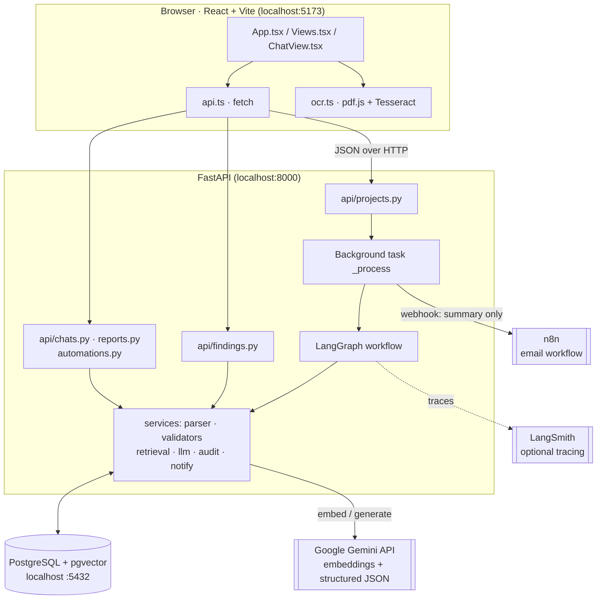
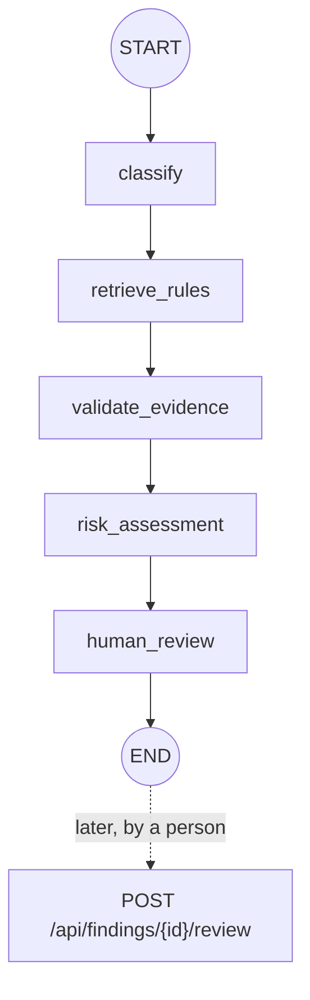
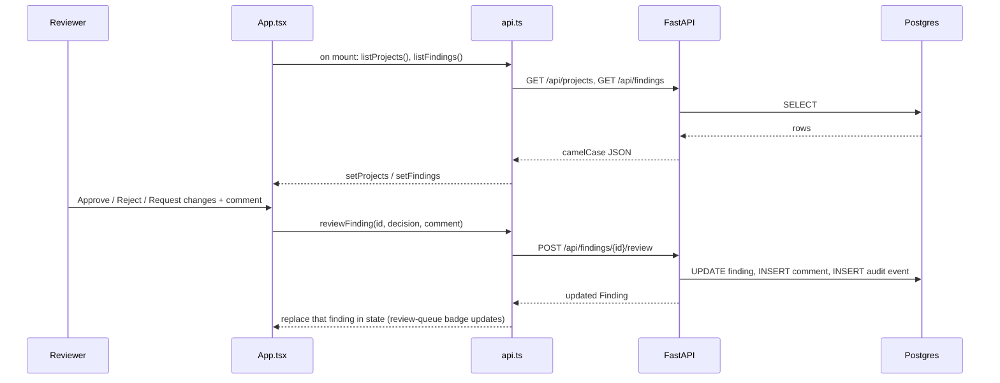

# FiberDoc AI – Project Overview

FiberDoc AI helps engineers review fiber-optic construction and design documents (PDF, DOCX, XLSX) against a set of
engineering rules. It extracts the document text, checks it against the rules, and produces **findings**. A **human
reviewer** then approves or rejects each finding.

**Core principle:** use deterministic Python wherever possible. The LLM only *interprets unstructured evidence* and
*explains*. It never invents values and never approves anything.

---

## 1. Tech stack: what, why, where, when

### Backend (`backend/`)

| Tech | What it does here | Why we chose it | Where | When it runs |
|---|---|---|---|---|
| **FastAPI** + **Uvicorn** | REST API server (`/api/...`, auto docs at `/docs`) | Fast, typed, async uploads, auto-generated OpenAPI docs | `app/main.py`, `app/api/*.py` | Always (the server process) |
| **Pydantic** | Validates request/response bodies. Converts `snake_case` to `camelCase` JSON. Also defines the *schemas the LLM must answer in* | Guarantees the API shape matches `frontend/src/types.ts`. Rejects malformed LLM output | `app/schemas.py` | Every request, and every LLM call |
| **SQLAlchemy 2** | ORM for the database tables | Typed models, works with `psycopg` and `pgvector` | `app/db/models.py`, `app/db/session.py` | Every DB access; tables are created at startup |
| **PostgreSQL 18 + pgvector** (local Windows service) | Stores all data **and** vector embeddings (`chunks.embedding`, `rules.embedding`) | One database for relational data and similarity search | Windows service `postgresql-x64-18`, port 5432, database `fiberdoc` (shared server; other projects use their own databases) | Always; vector search runs during the workflow |
| **PyMuPDF / python-docx / openpyxl** | Extract text, tables and page numbers from PDF / DOCX / XLSX | Reliable text-layer extraction that keeps page numbers, so findings can cite evidence | `app/services/document_parser.py` | Background job after upload |
| **LangGraph** | Orchestrates the 5-step review workflow as a state graph | Explicit, inspectable pipeline; the last node pauses at the human | `app/workflow/graph.py` | Background job after upload |
| **Google Gemini** (`google-genai`) | (a) Embeddings for rules and chunks. (b) Structured JSON answers for document classification and semantic rules | Strong, cheap embeddings and structured output. Wrapped in a swappable `LLMProvider` interface | `app/services/llm.py` | Embedding at upload; LLM only when rules need it |
| **Deterministic validators** (plain Python + regex) | Required terms, numeric minimums, cross-section consistency, quote-grounding | Exact, explainable, no hallucination | `app/services/validators.py` | During `validate_evidence` |
| **Hybrid retrieval** | Picks which rules apply and which chunks are evidence | Combines metadata filter, vector similarity and keyword match | `app/services/retrieval.py` | During `retrieve_rules` and `validate_evidence` |
| **LangSmith** (optional) | Traces LangGraph and Gemini question-and-answer calls (not embeddings) | Debugging and evaluation | `.env`: `LANGSMITH_*` | When `LANGSMITH_TRACING=true` |
| **Alembic** | Versioned schema migrations (`0001`–`0003`) | Safe, reversible schema changes on a database with real data | `backend/migrations/` | At startup (`init_db`), and by hand when changing the schema |
| **httpx** | Outbound webhook to n8n (token + HMAC signature, retries) | Simple sync client with timeouts | `app/services/notify.py` | When a document finishes, if automations are on |
| **Timing recorder** (`ContextVar`) | Time per workflow step and per Gemini call (attempts, errors, tokens) | Find where processing time goes before optimising | `app/services/timing.py` | Every processing run |
| **pytest** | Unit, integration, offline-eval and gated live-eval tests (123 passed, 4 skipped) | Guards the deterministic logic and the integrations | `backend/tests/` | On demand |

### Frontend (`frontend/`)

| Tech | What it does here | Why | Where | When |
|---|---|---|---|---|
| **React 19 + TypeScript** | UI: chat/upload, projects, findings, review queue | Component model and type-safety (`types.ts` mirrors backend schemas) | `src/*.tsx` | In the browser |
| **Vite** | Dev server and bundler (port 5173) | Fast HMR; exposes `VITE_*` env vars | `vite.config.js` | `npm run dev` / `npm run build` |
| **fetch (native)** | Calls the FastAPI backend | No extra dependency | `src/api.ts` | On page load and on each review action |
| **pdfjs-dist** | Reads PDF text layers in the browser | Instant preview text without the server | `src/ocr.ts` | When a file is attached in chat |
| **Tesseract.js** | Browser OCR for scanned PDFs and images | Works offline; the interim extractor until the backend handles uploads | `src/ocr.ts` | When a page has no text layer, or the file is an image |
| **oxlint** | Linting | Fast | `.oxlintrc.json` | `npm run lint` |

### Automation (`integrations/n8n/`)

| Tech | What it does here | Why | Where | When |
|---|---|---|---|---|
| **n8n** (self-hosted, `npx n8n`) | Receives FiberDoc's webhook and sends the summary email over SMTP | Notifications and later Slack/Jira steps without new FiberDoc code | `fiberdoc_email_workflow.json` | After each checked document |
| **n8n AI Agent + Gemini + Structured Output Parser** | Optional Think → Act agent that writes ordered next steps for the email | Two-step plan-then-act pattern with forced JSON output; suggestions only | `fiberdoc_think_act_workflow.json` | Only when a document has open findings |

### Config and secrets

| File | Holds |
|---|---|
| `backend/.env` | `DATABASE_URL`, `GEMINI_API_KEY`, `GEMINI_MODEL`, `GEMINI_EMBED_MODEL`, `EMBED_DIM`, `CORS_ORIGINS`, `MAX_UPLOAD_MB`, `UPLOAD_DIR`, `LANGSMITH_*` |
| `frontend/.env` | `VITE_API_URL=http://localhost:8000` (where the frontend finds the backend) |

---

## 2. System architecture



---

## 3. Where the data goes

| Data | Created by | Stored in | Read by |
|---|---|---|---|
| Project (name, location) | `POST /api/projects` | `projects` | `GET /api/projects` (with document count) |
| Uploaded file | `POST /api/projects/{id}/documents` | Original kept on disk at `UPLOAD_DIR/<project_id>/<document_id><ext>` (default `backend/data/uploads`); its SHA-256 is saved in `documents.sha256` | the background parser; `sha256` is returned in the API |
| Document record (status, type, pages, error) | upload endpoint, then workflow | `documents` | `GET /api/projects/{id}/documents` |
| Text chunks + embedding vectors | parser, then `embed_document_chunks` | `chunks` (`vector(768)`) | retrieval and validation |
| Rules + embeddings | `seed_rules` (also auto-seeded at server start; embeddings need the Gemini key) | `rules` | retrieval and validation |
| Findings (always created `pending`), with `status`, `evidence[]`, `source_pages_checked`, `recommended_action`, `needs_human_review` and a `retrieval` trace (rule as used, rank and scores, evidence chunks shown to the LLM) | workflow node `human_review` | `findings` | `GET /api/findings`, finding card, HTML report |
| Review decision + comments | `POST /api/findings/{id}/review` | `findings.decision`, `review_comments` | the frontend |
| Audit trail (`workflow_completed` also holds every retrieved rule with its rank and scores; `processing_timed` holds the timing breakdown) | every key action | `audit_events` | timings via `GET /api/documents/{id}/timings`; the rest not in the UI yet |
| Chats and their messages | `POST /api/chats`, the upload endpoint, `record_outcome` | `chats`, `chat_messages` | the sidebar's Recent chats |
| Webhook settings + delivery log | ⚡ Automations page, `notify_document_checked` | `automation_settings`, `webhook_deliveries` | the ⚡ Automations page |

**What leaves your machine:** chunk text and rule text are sent to **Google Gemini** for embeddings. For semantic
rules and classification, excerpts are also sent to Gemini for structured answers. If LangSmith tracing is on, run
traces go to LangSmith too. If automations are on, a **summary** (never the document text) goes to your n8n
workflow, and with the Think → Act workflow n8n sends that summary to Gemini.

**Document status lifecycle:** `processing` → `awaiting_review` (or `error`, with the message saved in `documents.error`).

---

## 4. Backend workflow (upload → findings)

### Step A: Upload (synchronous, fast)
`POST /api/projects/{project_id}/documents` (`api/projects.py`)
1. Check the project exists (404 otherwise).
2. `validate_upload`: extension must be `.pdf`, `.docx` or `.xlsx`, the file must be non-empty, and it must be under `MAX_UPLOAD_MB`.
3. Compute the SHA-256, create a `Document` row with `status="processing"`, save the original under `UPLOAD_DIR`, and record an audit event (with the checksum, and `duplicate_of` if an identical file is already in the project; duplicates are still processed).
4. Queue `_process` as a **background task** and return **202** straight away.

### Step B: Background job `_process`
1. **Parse** (`document_parser.py`): PDF uses PyMuPDF text and tables. DOCX uses paragraphs and tables, treated as page 1. XLSX uses one chunk group per sheet, with the sheet index standing in for the page. Text is split into chunks of at most 1500 characters on paragraph boundaries. Each chunk keeps its `page`.
2. **Save chunks** to `chunks`.
3. **Embed** every chunk with Gemini (`embed_document_chunks`, batches of 50).
4. **Run the LangGraph workflow.**
5. On any exception, set `status="error"` and save the message. The stored original is kept either way.
6. Save the timing breakdown (`processing_timed` audit event), write the result message into the chat, then send the
   webhook if automations are on (it never raises).

### Step C: The LangGraph pipeline (`workflow/graph.py`)



| Node | What happens | Deterministic or LLM? |
|---|---|---|
| **classify** | Counts keyword hits per doc type (construction_plan, design_summary, as_built, permit, test_report). With **≥ 2 hits** it picks the best type. Otherwise it asks Gemini for a `DocClassification`. If the LLM fails, the type is `other` | Mostly deterministic; LLM is the fallback |
| **retrieve_rules** | Filters rules by `applies_to` (doc type). Ranks them by `0.7 × vector similarity` (mean of chunk embeddings vs rule embedding) `+ 0.3 × keyword hit-rate`. Returns up to 20 | Deterministic and vector math |
| **validate_evidence** | For each rule: if the `check_type` is `required_term`, `numeric_min`, `numeric_max` or `consistency`, run the Python check. If `semantic`, fetch the top-4 most similar chunks, ask Gemini for an `EvidenceCheck` (quote, page, complies yes/no/unclear, explanation), then **verify the quote appears verbatim** in those chunks. Ungrounded quotes are dropped | Rules: deterministic. Semantic: LLM plus a verification guard |
| **risk_assessment** | Starts from the rule's severity. Passed checks become `low` ("requirement met"). Unverified AI answers are **downgraded one level, never escalated** | Deterministic |
| **human_review** | Saves every finding to the DB as **`pending`**. Sets the document to `awaiting_review`. Writes an audit event. The graph ends. **Nothing is auto-approved** | Deterministic |

### Rule check types (`validators.py`; rules in `backend/reference/demo_rule_catalogue.md`, parsed by `seed_rules.py`)
| `check_type` | Meaning | Example |
|---|---|---|
| `required_term` | A pattern must appear somewhere | QA-014 OTDR results, DSN-011 bend radius |
| `numeric_min` | Extracted numbers must be ≥ a minimum (lowest value is checked) | CON-007 burial depth ≥ 36 in |
| `numeric_max` | Extracted numbers must be ≤ a maximum (highest value is checked; no value found = "could not verify") | QA-021 splice loss ≤ 0.15 dB, CON-012 handhole spacing ≤ 300 m |
| `consistency` | Two sections must state the same number | DSN-003 fiber count (summary vs schedule) |
| `semantic` | Needs interpretation, so the LLM is used with grounding | PRM-002 permit attached, LBL-001 labelling |

### Safety guards
- LLM quotes must be **verbatim** in the document (`quote_is_grounded`), or they are dropped.
- LLM failure produces a *"manual review needed"* finding, never a made-up result.
- LLM temperature is `0.0`, and its output must validate against a Pydantic schema.
- Only `POST /review` can change a decision, and that change is audited with before and after values.

### Step D: Human review
`POST /api/findings/{id}/review` with `{decision, comment}`. The decision is one of `approved`, `rejected` or
`changes_requested`. The backend updates the finding, adds a `ReviewComment` if given, writes an audit event
and returns the updated finding.

### Endpoints
| Method | Path | Purpose |
|---|---|---|
| GET | `/health` | Liveness check |
| GET / POST | `/api/projects` | List, create |
| GET | `/api/projects/{id}/documents` | List documents and their status |
| POST | `/api/projects/{id}/documents` | Upload a file (returns 202) |
| GET | `/api/findings?project_id=` | List findings (optional filter) |
| POST | `/api/findings/{id}/review` | Record a human decision |
| GET | `/api/documents/{id}/timings` | Timing breakdown of the latest processing run |
| GET | `/api/projects/{id}/report` | Downloadable HTML report |
| GET / POST | `/api/chats` | List saved chats, create one |
| GET | `/api/chats/{id}` | A chat with its messages and documents |
| POST | `/api/chats/{id}/messages` | Add a message |
| GET / PUT | `/api/automations/settings` | Webhook URL, recipient, on/off |
| POST | `/api/automations/settings/secret` | Create a new shared token |
| POST | `/api/automations/test` | Send a labelled test event |
| GET | `/api/automations/deliveries` | Delivery log |

---

## 5. Frontend workflow

### Structure (`src/App.tsx`)
`App` holds the state: `projects`, `findings`, chats and the current view. The sidebar switches between five views, with Recent chats always listed below them.

| View | Component | Shows |
|---|---|---|
| 💬 Chat & upload | `ChatView.tsx`, `ResultPanel.tsx` | Attach documents, upload and check them; saved chats and their results |
| 🗂 Projects | `DashboardView` (`Views.tsx`) | Projects and finding counts; opening one jumps to Findings |
| ⚡ Automations | `AutomationsView.tsx` | Where the data goes, webhook settings and token, Send test, delivery log |
| 🔍 Findings | `FindingsView` + `FindingCard.tsx` | Findings, filterable by project, with evidence quote, rule text, explanation |
| ✅ Review queue | `ReviewQueueView` | `pending` findings with a badge count |

### Data flow (current)


### Chat and upload
1. The user attaches PDF, DOCX or XLSX files and picks a project. On its first message the chat is saved (`POST /api/chats`).
2. Each file is uploaded with the chat's ID (`POST /api/projects/{id}/documents`, `chat_id`). The backend saves an `upload` message and checks the file in the background.
3. When the workflow ends, the backend saves a `result` (or `error`) message in that chat (`app/services/chat_log.py`). The open tab polls the document status, then shows that saved message. The result panel (`ResultPanel.tsx`) shows progress, details, a status summary and the findings.
4. For PDFs, a preview is also read **in the browser** (`ocr.ts`: pdf.js text layer, Tesseract OCR for empty pages). It is used only for the "Extracted text" tab and only exists in that session.
5. Saved chats appear under "Recent chats". Opening one loads its messages and documents (`savedChat.ts`), and a document still being checked is polled until its result is saved.

---

## 6. Current status: what is connected and what isn't

| Area | Status |
|---|---|
| Backend API, workflow, validators, retrieval, audit | Built |
| Frontend → backend for **projects, findings, reviews** | **Connected** (`api.ts` uses `fetch` with `VITE_API_URL`) |
| Frontend **file upload** → `POST /api/projects/{id}/documents` | **Connected.** Chat has a project picker, uploads PDF/DOCX/XLSX, polls the document status and posts a findings summary. A browser OCR preview still runs for PDFs |
| UI to **create a project** | Built (Projects page) |
| **Downloadable report** (`GET /api/projects/{id}/report`) | **Built.** Self-contained HTML with summary, documents, findings, evidence, decisions and comments; "Download report" button on the Findings page (project selected) |
| `GEMINI_API_KEY` | Set in `backend/.env`. Models in use: `gemini-embedding-001` (768-dim) and `gemini-3.8-flash`. Gemini calls retry transient 503/429 errors |
| Evaluation set | Offline: `backend/tests/test_eval_rules.py` runs the deterministic rules on the defective sample PDF (S4), a compliant one (S5) and an undeterminable case. Live: `backend/tests/test_eval_semantic.py` checks PRM-002 / LBL-001 against S4-S7 using real Gemini calls; skipped unless `RUN_LIVE_EVAL=1`, and skips when Gemini is unavailable. **Live cases have not yet passed**: the free-tier daily quota (20 requests/day on `gemini-3.8-flash`) ran out on 2026-11-09. Generators: `sample_docs/make_sample.py`, `make_variants.py`. End-to-end harness: `python -m evals.run_eval` (last run 2026-11-09, before the 20-rule catalogue, so out of date). Whole suite: 123 passed, 4 skipped (2026-11-16) |
| Checksum + original storage | **Built.** `documents.sha256` / `stored_path`, `app/services/storage.py`, `tests/test_storage.py`. Schema changes are Alembic migrations (`backend/migrations/`), applied at startup. Stored files are not yet served back or deleted with their project |
| Rule catalogue metadata | **Built.** Each rule has `source_name`, `section`, `jurisdiction`, `standard_family`, `version`, `effective_date`, `status` (placeholder values `DEMO-REGION-A` / `DEMO-STD-1` / `0.2`). `retrieve_rules` filters on `status='approved'` and optional jurisdiction / standard family BEFORE ranking. The catalogue is labelled **non-authoritative** in the report, in the UI banner and in `seed_rules.py` |
| Demo rule catalogue | **Built.** 20 rules in 8 sections (QA, Design, Construction, Permits, Labelling, Safety, As-built, Splicing) in `backend/reference/demo_rule_catalogue.md`, marked NON-AUTHORITATIVE. `seed_rules.py` parses and validates it (severity, document types, regexes, duplicate IDs) and syncs the database on startup: changed text clears the rule's embedding so it is re-embedded, and rules removed from the file are marked `retired`, not deleted. 18 rules are deterministic and only 2 use Gemini. Every rule has a passing and a failing example, which `tests/test_catalogue.py` runs |
| Finding traceability | **Built.** Each finding stores a check status (passed / failed / missing_evidence / needs_review, as in the blueprint), all evidence quotes (both sides of a consistency check), pages checked, a deterministic recommended action, a needs-human-review flag, and a retrieval trace. The audit event lists every retrieved rule with scores (input for the future Recall@K eval). Findings created before 2026-11-12 have `null` for these fields |
| Classification | **Known issue.** Keyword hits are counted over the whole text with equal weight, so a construction plan with "Design summary" section headings is classified as `design_summary`, and construction-only rules are skipped |
| Chat history | **Built.** Tables `chats` / `chat_messages` (Alembic `0002`), `/api/chats` endpoints, upload and result messages written by the backend, saved chats in the sidebar (`backend/tests/test_chats.py`) |
| Automations (n8n email) | **Built.** ⚡ Automations page; outbound webhook with a token and signature, retries and a delivery log (tables `automation_settings` / `webhook_deliveries`, Alembic `0003`); importable n8n workflow and guide in `integrations/n8n/` (`backend/tests/test_notify.py`) |
| Chat Q&A | Not built (the chat says so) |
| Undeterminable checks | A deterministic check that cannot find its data (e.g. only one of two numbers) now raises a "Could not verify automatically… Manual review needed" finding (`validate` in `graph.py`) |
| Auth | Not built (`users` table exists, no login; reviewer is hard-coded as "Reviewer") |
| Processing timings | **Built.** Per-step and per-Gemini-call times in the result panel ("Where the time went"). It showed most of a slow run was Gemini 503/504 retries; the speed fix is not built yet |
| Not built yet | PostGIS/GeoJSON, LangSmith eval dataset, Cloud Run deployment, React/Playwright tests |

### Target design: the blueprint (not fully built)
The full spec is in [`docs/blueprint.md`](docs/blueprint.md). Where the build stands against it:

| Blueprint section | Built | Missing |
|---|---|---|
| 1–2 Purpose, user journey | Upload with checksum, extraction with pages, retrieval, validation, review, report, non-authoritative labels | Document *sections* (only pages are tracked) |
| 3–4 Architecture, stack | FastAPI, Pydantic, LangGraph, Gemini behind a provider interface, pgvector, parsers, LangSmith, pytest | MUI, Docker + Cloud Run deployment, React Testing Library, Playwright, auth |
| 5 Workflow | 5-node graph (the section 3 diagram); finding fields from the example JSON; four statuses | Intake / Extract / Report nodes, checkpointed pause/resume, typed state, versioned reports; classifier mislabels construction plans |
| 6 RAG | 20 rules from a reference document, rule-sized chunks, all metadata, filters before ranking, hybrid ranking, retrieved IDs and excerpts on each finding | Query built from doc type + requirement (rules are matched against the averaged whole document), Recall@K |
| 7 Risk, confidence | Per-rule severity | 5/3/1 × status-multiplier score (0–100), risk band, completeness score, confidence reasons |
| 8 Database | users, projects, documents, chunks, rules, findings, comments, audit events | `rule_chunks`, `reviews` (reviewer_id, reviewed_at), chunk `section`, document `version`, project region/type, `updated_at`, `confidence_reason`, indexes, migrations |
| 9–10 API, screens | Projects, upload, findings, review, project report; dashboard, upload, findings, review queue | Login, `/documents/{id}/…` endpoints, separate `/validate`, audit timeline, summary score, decision history |
| 11 GIS | – | GeoJSON boundary/points, coordinate checks, PostGIS point-in-boundary, Leaflet map |
| 12 Eval, guardrails | Pydantic output, deterministic arithmetic, human approval, "insufficient evidence", grounded quotes, timeout/duplicate handling, about 7 eval cases | 10–20 labelled files, Recall@3/@5, finding precision/recall, run logging (run ID, node, latency, tokens, model), cited rule IDs checked against retrieved ones, prompt-injection handling, versioned prompts and models |

### Suggested next steps
The up-to-date list, with reasons, is in [TODO.md](TODO.md).

1. Fix document classification (weight the title above section headings).
2. Recall@3 / Recall@5 on 10–20 labelled cases, plus finding precision and recall. Then fix the retrieval query direction if the numbers show it's needed.
3. Risk score and confidence reasons (section 7), shown in the report and UI.
4. 7-node workflow with checkpointed pause/resume and versioned reports.
5. Auth, document-level API, audit timeline.
6. GIS extension.
7. Docker + Cloud Run deployment and Playwright tests, last, once the features are stable.

---

## 7. Run it

```powershell
# Database: local Windows PostgreSQL 18 service (postgresql-x64-18, port 5432) with pgvector 0.8.7
# built from source (MSVC Build Tools). One-time setup as the postgres superuser:
#   CREATE ROLE fiberdoc LOGIN PASSWORD '...';  CREATE DATABASE fiberdoc OWNER fiberdoc;
#   \c fiberdoc   CREATE EXTENSION vector;
# Put the password in backend/.env DATABASE_URL (URL-encode special characters, e.g. $ -> %24).

# Backend (from backend/)
.venv\Scripts\activate
python -m app.workflow.seed_rules      # needs GEMINI_API_KEY
uvicorn app.main:app --port 8000      # http://localhost:8000/docs; migrations run at startup
                                       # (--reload works in a normal terminal; it can hang in a background shell on Windows)

# Frontend (from frontend/)
npm install
npm run dev                            # http://localhost:5173
```
