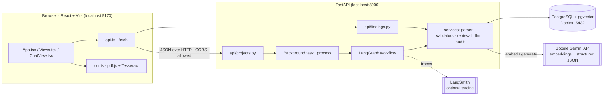
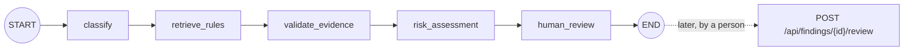
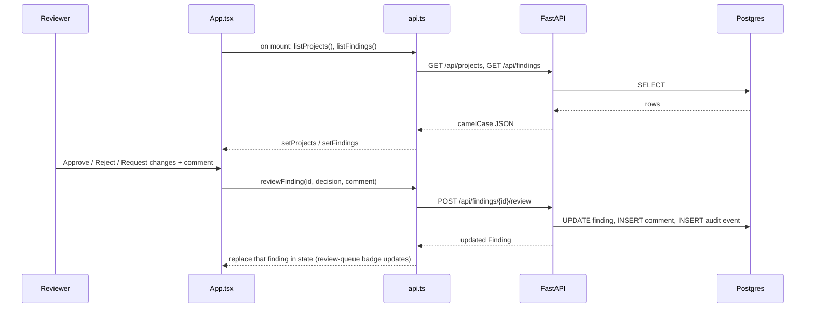

# FiberDoc AI – Project Overview

FiberDoc AI helps engineers review fiber-optic construction and design documents (PDF, DOCX, XLSX) against a set of
engineering rules. It extracts the document text, checks it against the rules, and produces **findings**. A **human
reviewer** then approves or rejects each finding.

**Core principle:** use deterministic Python wherever possible. The LLM only *interprets unstructured evidence* and
*explains*. It never invents values and never approves anything.

---

## 1. Tech stack: what, why, where, when

### Backend (`backend/`)

| Tech | What it does here | Why we chose it | Where | When it runs |
|---|---|---|---|---|
| **FastAPI** + **Uvicorn** | REST API server (`/api/...`, auto docs at `/docs`) | Fast, typed, async uploads, auto-generated OpenAPI docs | `app/main.py`, `app/api/*.py` | Always (the server process) |
| **Pydantic** | Validates request/response bodies. Converts `snake_case` to `camelCase` JSON. Also defines the *schemas the LLM must answer in* | Guarantees the API shape matches `frontend/src/types.ts`. Rejects malformed LLM output | `app/schemas.py` | Every request, and every LLM call |
| **SQLAlchemy 2** | ORM for the database tables | Typed models, works with `psycopg` and `pgvector` | `app/db/models.py`, `app/db/session.py` | Every DB access; tables are created at startup |
| **PostgreSQL 16 + pgvector** (Docker) | Stores all data **and** vector embeddings (`chunks.embedding`, `rules.embedding`) | One database for relational data and similarity search | `docker-compose.yml` (`db` service, port 5432) | Always; vector search runs during the workflow |
| **PyMuPDF / python-docx / openpyxl** | Extract text, tables and page numbers from PDF / DOCX / XLSX | Reliable text-layer extraction that keeps page numbers, so findings can cite evidence | `app/services/document_parser.py` | Background job after upload |
| **LangGraph** | Orchestrates the 5-step review workflow as a state graph | Explicit, inspectable pipeline; the last node pauses at the human | `app/workflow/graph.py` | Background job after upload |
| **Google Gemini** (`google-genai`) | (a) Embeddings for rules and chunks. (b) Structured JSON answers for document classification and semantic rules | Strong, cheap embeddings and structured output. Wrapped in a swappable `LLMProvider` interface | `app/services/llm.py` | Embedding at upload; LLM only when rules need it |
| **Deterministic validators** (plain Python + regex) | Required terms, numeric minimums, cross-section consistency, quote-grounding | Exact, explainable, no hallucination | `app/services/validators.py` | During `validate_evidence` |
| **Hybrid retrieval** | Picks which rules apply and which chunks are evidence | Combines metadata filter, vector similarity and keyword match | `app/services/retrieval.py` | During `retrieve_rules` and `validate_evidence` |
| **LangSmith** (optional) | Traces LangGraph and Gemini question-and-answer calls (not embeddings) | Debugging and evaluation | `.env`: `LANGSMITH_*` | When `LANGSMITH_TRACING=true` |
| **pytest** | Tests for validators and parser | Guards the deterministic logic | `backend/tests/` | On demand |

### Frontend (`frontend/`)

| Tech | What it does here | Why | Where | When |
|---|---|---|---|---|
| **React 19 + TypeScript** | UI: chat/upload, projects, findings, review queue | Component model and type-safety (`types.ts` mirrors backend schemas) | `src/*.tsx` | In the browser |
| **Vite** | Dev server and bundler (port 5173) | Fast HMR; exposes `VITE_*` env vars | `vite.config.js` | `npm run dev` / `npm run build` |
| **fetch (native)** | Calls the FastAPI backend | No extra dependency | `src/api.ts` | On page load and on each review action |
| **pdfjs-dist** | Reads PDF text layers in the browser | Instant preview text without the server | `src/ocr.ts` | When a file is attached in chat |
| **Tesseract.js** | Browser OCR for scanned PDFs and images | Works offline; the interim extractor until the backend handles uploads | `src/ocr.ts` | When a page has no text layer, or the file is an image |
| **oxlint** | Linting | Fast | `.oxlintrc.json` | `npm run lint` |

### Config and secrets

| File | Holds |
|---|---|
| `backend/.env` | `DATABASE_URL`, `GEMINI_API_KEY`, `GEMINI_MODEL`, `GEMINI_EMBED_MODEL`, `EMBED_DIM`, `CORS_ORIGINS`, `MAX_UPLOAD_MB`, `UPLOAD_DIR`, `LANGSMITH_*` |
| `frontend/.env` | `VITE_API_URL=http://localhost:8000` (where the frontend finds the backend) |

---

## 2. System architecture



---

## 3. Where the data goes

| Data | Created by | Stored in | Read by |
|---|---|---|---|
| Project (name, location) | `POST /api/projects` | `projects` | `GET /api/projects` (with document count) |
| Uploaded file | `POST /api/projects/{id}/documents` | Original kept on disk at `UPLOAD_DIR/<project_id>/<document_id><ext>` (default `backend/data/uploads`); its SHA-256 is saved in `documents.sha256` | the background parser; `sha256` is returned in the API |
| Document record (status, type, pages, error) | upload endpoint, then workflow | `documents` | `GET /api/projects/{id}/documents` |
| Text chunks + embedding vectors | parser, then `embed_document_chunks` | `chunks` (`vector(768)`) | retrieval and validation |
| Rules + embeddings | `seed_rules` (also auto-seeded at server start; embeddings need the Gemini key) | `rules` | retrieval and validation |
| Findings (always created `pending`) | workflow node `human_review` | `findings` | `GET /api/findings` |
| Review decision + comments | `POST /api/findings/{id}/review` | `findings.decision`, `review_comments` | the frontend |
| Audit trail | every key action | `audit_events` | (not exposed in the UI yet) |

**What leaves your machine:** chunk text and rule text are sent to **Google Gemini** for embeddings. For semantic
rules and classification, excerpts are also sent to Gemini for structured answers. If LangSmith tracing is on, run
traces go to LangSmith too.

**Document status lifecycle:** `processing` → `awaiting_review` (or `error`, with the message saved in `documents.error`).

---

## 4. Backend workflow (upload → findings)

### Step A: Upload (synchronous, fast)
`POST /api/projects/{project_id}/documents` (`api/projects.py`)
1. Check the project exists (404 otherwise).
2. `validate_upload`: extension must be `.pdf`, `.docx` or `.xlsx`, the file must be non-empty, and it must be under `MAX_UPLOAD_MB`.
3. Compute the SHA-256, create a `Document` row with `status="processing"`, save the original under `UPLOAD_DIR`, and record an audit event (with the checksum, and `duplicate_of` if an identical file is already in the project; duplicates are still processed).
4. Queue `_process` as a **background task** and return **202** straight away.

### Step B: Background job `_process`
1. **Parse** (`document_parser.py`): PDF uses PyMuPDF text and tables. DOCX uses paragraphs and tables, treated as page 1. XLSX uses one chunk group per sheet, with the sheet index standing in for the page. Text is split into chunks of at most 1500 characters on paragraph boundaries. Each chunk keeps its `page`.
2. **Save chunks** to `chunks`.
3. **Embed** every chunk with Gemini (`embed_document_chunks`, batches of 50).
4. **Run the LangGraph workflow.**
5. On any exception, set `status="error"` and save the message. The stored original is kept either way.

### Step C: The LangGraph pipeline (`workflow/graph.py`)



| Node | What happens | Deterministic or LLM? |
|---|---|---|
| **classify** | Counts keyword hits per doc type (construction_plan, design_summary, as_built, permit, test_report). With **≥ 2 hits** it picks the best type. Otherwise it asks Gemini for a `DocClassification`. If the LLM fails, the type is `other` | Mostly deterministic; LLM is the fallback |
| **retrieve_rules** | Filters rules by `applies_to` (doc type). Ranks them by `0.7 × vector similarity` (mean of chunk embeddings vs rule embedding) `+ 0.3 × keyword hit-rate`. Returns up to 20 | Deterministic and vector math |
| **validate_evidence** | For each rule: if the `check_type` is `required_term`, `numeric_min` or `consistency`, run the Python check. If `semantic`, fetch the top-4 most similar chunks, ask Gemini for an `EvidenceCheck` (quote, page, complies yes/no/unclear, explanation), then **verify the quote appears verbatim** in those chunks. Ungrounded quotes are dropped | Rules: deterministic. Semantic: LLM plus a verification guard |
| **risk_assessment** | Starts from the rule's severity. Passed checks become `low` ("requirement met"). Unverified AI answers are **downgraded one level, never escalated** | Deterministic |
| **human_review** | Saves every finding to the DB as **`pending`**. Sets the document to `awaiting_review`. Writes an audit event. The graph ends. **Nothing is auto-approved** | Deterministic |

### Rule check types (`validators.py`, rules in `seed_rules.py`)
| `check_type` | Meaning | Example |
|---|---|---|
| `required_term` | A pattern must appear somewhere | QA-014 OTDR results, DSN-011 bend radius |
| `numeric_min` | Extracted numbers must be ≥ a minimum | CON-007 burial depth ≥ 36 in |
| `consistency` | Two sections must state the same number | DSN-003 fiber count (summary vs schedule) |
| `semantic` | Needs interpretation, so the LLM is used with grounding | PRM-002 permit attached, LBL-001 labelling |

### Safety guards
- LLM quotes must be **verbatim** in the document (`quote_is_grounded`), or they are dropped.
- LLM failure produces a *"manual review needed"* finding, never a made-up result.
- LLM temperature is `0.0`, and its output must validate against a Pydantic schema.
- Only `POST /review` can change a decision, and that change is audited with before and after values.

### Step D: Human review
`POST /api/findings/{id}/review` with `{decision, comment}`. The decision is one of `approved`, `rejected` or
`changes_requested`. The backend updates the finding, adds a `ReviewComment` if given, writes an audit event
and returns the updated finding.

### Endpoints
| Method | Path | Purpose |
|---|---|---|
| GET | `/health` | Liveness check |
| GET / POST | `/api/projects` | List, create |
| GET | `/api/projects/{id}/documents` | List documents and their status |
| POST | `/api/projects/{id}/documents` | Upload a file (returns 202) |
| GET | `/api/findings?project_id=` | List findings (optional filter) |
| POST | `/api/findings/{id}/review` | Record a human decision |

---

## 5. Frontend workflow

### Structure (`src/App.tsx`)
`App` holds the state: `projects`, `findings`, chats and the current view. The sidebar switches between four views.

| View | Component | Shows |
|---|---|---|
| 💬 Chat & upload | `ChatView.tsx` | Drag-and-drop or attach documents, then in-browser text extraction |
| 🗂 Projects | `DashboardView` (`Views.tsx`) | Projects and finding counts; opening one jumps to Findings |
| 🔍 Findings | `FindingsView` + `FindingCard.tsx` | Findings, filterable by project, with evidence quote, rule text, explanation |
| ✅ Review queue | `ReviewQueueView` | `pending` findings with a badge count |

### Data flow (current)


### Chat and upload (current, client-side only)
1. The user attaches PDFs, images or text files. `isSupported()` filters the types.
2. `ocr.ts` `extractText()` runs **in the browser**. Text files are read directly. Images go to Tesseract OCR. PDFs use pdf.js to read the text layer page by page. A page with fewer than 20 characters is rendered to a canvas and OCR'd.
3. A progress bar shows `Reading page i/n` or `OCR page i/n`. The user can open the extracted text in the side panel.
4. The assistant reply is a **placeholder**. Nothing is sent to the backend yet.

---

## 6. Current status: what is connected and what isn't

| Area | Status |
|---|---|
| Backend API, workflow, validators, retrieval, audit | Built |
| Frontend → backend for **projects, findings, reviews** | **Connected** (`api.ts` uses `fetch` with `VITE_API_URL`) |
| Frontend **file upload** → `POST /api/projects/{id}/documents` | **Connected.** Chat has a project picker, uploads PDF/DOCX/XLSX, polls the document status and posts a findings summary. A browser OCR preview still runs for PDFs |
| UI to **create a project** | Built (Projects page) |
| **Downloadable report** (`GET /api/projects/{id}/report`) | **Built.** Self-contained HTML with summary, documents, findings, evidence, decisions and comments; "Download report" button on the Findings page (project selected) |
| `GEMINI_API_KEY` | Set in `backend/.env`. Models in use: `gemini-embedding-001` (768-dim) and `gemini-3.8-flash`. Gemini calls retry transient 503/429 errors |
| Evaluation set | Offline: `backend/tests/test_eval_rules.py` runs the deterministic rules on the defective sample PDF (S4), a compliant one (S5) and an undeterminable case. Live: `backend/tests/test_eval_semantic.py` checks PRM-002 / LBL-001 against S4-S7 using real Gemini calls; skipped unless `RUN_LIVE_EVAL=1`, and skips when Gemini is unavailable. **Live cases have not yet passed**: the free-tier daily quota (20 requests/day on `gemini-3.8-flash`) ran out on 2026-11-09. Generators: `sample_docs/make_sample.py`, `make_variants.py`. 24 offline tests pass |
| Checksum + original storage | **Built.** `documents.sha256` / `stored_path`, `app/services/storage.py`, `tests/test_storage.py`. New columns are added at startup with `ALTER TABLE … IF NOT EXISTS` (no Alembic yet). Stored files are not yet served back or deleted with their project |
| Chat Q&A | Not built (the chat says so) |
| Undeterminable checks | A deterministic check that cannot find its data (e.g. only one of two numbers) now raises a "Could not verify automatically… Manual review needed" finding (`validate` in `graph.py`) |
| Auth | Not built (`users` table exists, no login; reviewer is hard-coded as "Reviewer") |
| Not built yet | PostGIS/GeoJSON, LangSmith eval dataset, Cloud Run deployment, Alembic migrations (tables are created at startup), React/Playwright tests |

### Suggested next steps
1. Run the live semantic evaluation once the Gemini quota allows, and tune the PRM-002 / LBL-001 prompts from the LangSmith traces.
2. Add auth, so reviewer names in the audit trail are real; then consider deployment.

---

## 7. Run it

```powershell
# Backend (from backend/)
docker compose up -d db
.venv\Scripts\activate
python -m app.workflow.seed_rules      # needs GEMINI_API_KEY
uvicorn app.main:app --reload          # http://localhost:8000/docs

# Frontend (from frontend/)
npm install
npm run dev                            # http://localhost:5173
```
