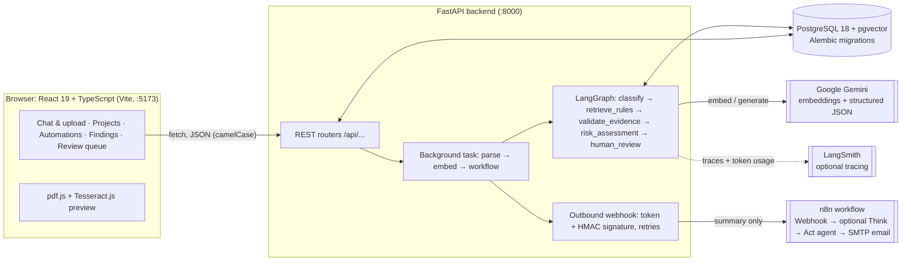

# FiberDoc AI

FiberDoc AI does a first-pass review of fiber-optic (outside plant) construction documents: construction plans,
design summaries, as-builts, permits and test reports. You upload a PDF, DOCX or XLSX file. FiberDoc extracts the
text with page numbers, picks the engineering rules that apply, checks the document against each one, and produces
**findings** with evidence quotes. **A human reviewer then approves or rejects every finding.** Nothing is
approved automatically.

> **Demo rules, not real standards.** The 20-rule catalogue in `backend/reference/demo_rule_catalogue.md` is
> **non-authoritative**: the requirements and limits are invented examples. The app, its reports and this README all
> say so. All sample projects and values are fictional.

**Design principle:** use deterministic Python wherever a rule can be checked exactly. The LLM is used only to
*interpret unstructured evidence* and to *explain*. It never invents values, and it never approves anything.

---

## Contents
1. [What it does](#what-it-does)
2. [Architecture](#architecture)
3. [Technology stack](#technology-stack)
4. [Techniques used](#techniques-used)
5. [Where the data goes](#where-the-data-goes)
6. [Project layout](#project-layout)
7. [Running it locally](#running-it-locally)
8. [Testing and evaluation](#testing-and-evaluation)
9. [Status and roadmap](#status-and-roadmap)
10. [Further documentation](#further-documentation)

---

## What it does

1. **Upload.** In *Chat & upload*, pick a project and attach one or more documents. Each upload is validated (type,
   size, not empty), fingerprinted with SHA-256, stored on disk and queued. The API returns `202 Accepted` straight away.
2. **Extract.** Text and tables are pulled out of the file with their page numbers (or sheet numbers for XLSX), then
   split into chunks and embedded.
3. **Check.** A LangGraph workflow classifies the document type, retrieves the relevant rules, checks each rule
   (deterministic checks or a grounded Gemini check), and assigns a risk level.
4. **Review.** Every finding arrives as `pending`, with a status (passed / failed / missing evidence / needs review),
   evidence quotes and page numbers, a recommended action and a full retrieval trace. A reviewer approves, rejects
   or requests changes, with comments. Every decision is audited.
5. **Report and notify.** A self-contained HTML report can be downloaded per project. If automations are switched
   on, a summary is sent to an n8n workflow, which emails it, optionally with AI-suggested next steps.

**Screens** (sidebar): 💬 Chat & upload (with saved *Recent chats*) · 🗂 Projects · ⚡ Automations · 🔍 Findings ·
✅ Review queue.

---

## Architecture



---

## Technology stack

### Backend: Python 3.13
| Technology | Used for |
|---|---|
| **FastAPI** + **Uvicorn** | REST API, background tasks for document processing, automatic OpenAPI docs at `/docs`, lifespan startup hook |
| **Pydantic v2** + **pydantic-settings** | Request/response models with `snake_case` → `camelCase` aliasing (they mirror `frontend/src/types.ts`). They also define the **JSON schemas the LLM must answer in**. Settings are typed and loaded from `.env` |
| **SQLAlchemy 2** (typed ORM) + **psycopg 3** | Database models and sessions |
| **Alembic** | Versioned schema migrations (`0001` baseline → `0002` chats → `0003` automations), run automatically at startup |
| **LangGraph** | The review pipeline as an explicit state graph of 5 nodes |
| **google-genai** (Gemini) | `gemini-embedding-001` (768-dimensional embeddings) and `gemini-3.8-flash` (structured JSON answers). Behind a swappable `LLMProvider` protocol |
| **LangSmith** | Optional tracing of the graph and every Gemini call, with token counts attached to each run |
| **PyMuPDF**, **python-docx**, **openpyxl** | Text and table extraction from PDF / DOCX / XLSX, keeping page or sheet numbers |
| **httpx** | Outbound webhook delivery (and the test client) |
| **pytest** | Unit, integration, offline-evaluation and gated live-evaluation tests |

### Data
| Technology | Used for |
|---|---|
| **PostgreSQL 18** (local Windows service) | All relational data: projects, documents, chunks, rules, findings, comments, audit events, chats, automation settings, webhook deliveries |
| **pgvector 0.8** | `vector(768)` columns on chunks and rules, with cosine similarity search in SQL |

### Frontend
| Technology | Used for |
|---|---|
| **React 19** + **TypeScript** | The single-page UI. `types.ts` mirrors the backend schemas |
| **Vite 8** | Dev server and production bundler; `VITE_API_URL` points at the backend |
| **Native `fetch`** | API client (`src/api.ts`), no HTTP library |
| **pdfjs-dist** + **Tesseract.js** | In-browser PDF text-layer reading and OCR for scanned pages, for the "Extracted text" preview |
| **oxlint** | Linting |

### Automation and integrations
| Technology | Used for |
|---|---|
| **n8n** (self-hosted with `npx n8n`, Node 24+) | Workflow automation *around* FiberDoc: receives the webhook and sends the email |
| **n8n LangChain nodes** | The optional **Think → Act** agent: two AI Agent nodes, each with a Gemini chat model and a Structured Output Parser |
| **SMTP** (e.g. Gmail with an App Password) | Email delivery from n8n |

### Tooling
Git and GitHub · a Python virtualenv · npm · pgAdmin, psql or DBeaver for the database · a `Dockerfile` for the
backend (Cloud Run deployment is planned, not done).

---

## Techniques used

### 1. Deterministic first, LLM only where needed
Each rule has a `check_type`. Four of the five types are plain Python and regex (`app/services/validators.py`), so
they are exact, explainable and can't hallucinate:

| `check_type` | Meaning | Example (demo rules) |
|---|---|---|
| `required_term` | A pattern must appear somewhere | QA-014 OTDR test results present |
| `numeric_min` | Every extracted value must be ≥ a minimum | CON-007 burial depth ≥ 36 in |
| `numeric_max` | Every extracted value must be ≤ a maximum | QA-021 splice loss ≤ 0.15 dB |
| `consistency` | Two sections must state the same number | DSN-003 fiber count, summary vs schedule |
| `semantic` | Needs interpretation, so Gemini is used, with grounding | PRM-002 permit attached, LBL-001 labelling |

18 of the 20 demo rules are deterministic. When a deterministic check can't find its data, the finding says
*"Could not verify automatically… manual review needed"*. It doesn't guess.

### 2. Hybrid retrieval (RAG over a rule catalogue)
`app/services/retrieval.py` picks which rules apply to a document, and which chunks count as evidence for each rule:
1. **Metadata filters first:** rule `status = approved`, document type in the rule's `applies_to`, plus optional
   jurisdiction and standard family.
2. **Then hybrid ranking:** `0.7 × cosine similarity` (pgvector, between the document's mean chunk embedding and the
   rule embedding) `+ 0.3 × keyword hit rate`. The top 20 are kept.
3. **Per-rule evidence:** the top 4 most similar chunks are what a semantic check sees.

Every finding stores the trace: the rule as used, its rank and scores, and the evidence chunks shown to the LLM.

### 3. Grounded, structured LLM output
- **Structured output:** Gemini must answer as JSON matching a Pydantic schema (`EvidenceCheck`, `DocClassification`).
  Temperature is `0.0`.
- **Quote verification:** the model must quote the document. `quote_is_grounded` checks that the quote appears
  **verbatim** in the excerpts. An answer whose quote isn't there becomes *needs review*: an uncited claim is never
  accepted as a result.
- **Safe failure:** if Gemini fails, the finding is *"Automatic interpretation failed; manual review needed"*,
  never a made-up result.
- **Risk is deterministic:** the rule's severity sets the risk. Unverified AI answers are downgraded one level and
  never escalated.

### 4. Agentic workflow as an explicit state graph
`app/workflow/graph.py` builds a LangGraph `StateGraph` with a typed state:
`classify → retrieve_rules → validate_evidence → risk_assessment → human_review`. Classification counts keyword
hits per document type and uses Gemini only as a fallback when there are fewer than 2 hits. Every node is wrapped
in a timer.

### 5. Human in the loop and auditability
- Findings are always created `pending`. Only `POST /api/findings/{id}/review` changes a decision.
- Every key action (upload, workflow completion, review, settings changes, timings) is written to `audit_events`
  with before and after values where relevant.
- Each finding carries its status, all evidence quotes (both sides of a consistency check), the pages checked,
  a recommended action, a needs-human-review flag and the retrieval trace.

### 6. The rule catalogue is data, not code
The rules live in a Markdown file that `seed_rules.py` parses and validates: severities, document types, regexes
and duplicate IDs. The database is synced on every startup:
- When a rule's text changes, its embedding is cleared so it gets re-embedded.
- A rule removed from the file is marked `retired`, never deleted, so old findings keep their rule.

Each rule has a passing and a failing example, and `tests/test_catalogue.py` runs them all. Rule metadata (source,
section, jurisdiction, standard family, version, effective date) uses clearly fake placeholders such as
`DEMO-REGION-A`.

### 7. Resilience
- **Retries with exponential backoff** (1 s, 2 s, 4 s) for transient Gemini errors (5xx, 429); other errors fail
  fast.
- **A request timeout** on every Gemini call, so a stalled request can't leave a document *processing* forever.
- **Interrupted-upload recovery:** at startup, any document still *processing* (its background task died with the
  server) is marked as an error, and its chat gets an explanation.
- **Duplicate detection:** the SHA-256 checksum flags an identical file already in the project (it is still
  processed, and the audit event records `duplicate_of`).

### 8. Observability and performance measurement
- **LangSmith** traces the graph and each Gemini call, with input, output and *thinking* token counts attached.
- **The timing recorder** (`app/services/timing.py`) uses a `ContextVar`, so it follows LangGraph into its worker
  threads. It records:
  - the time of every workflow step;
  - every Gemini call, with its duration including retries, the number of attempts, the errors seen and the tokens.
  
  The result is stored as an audit event, served at `GET /api/documents/{id}/timings`, and shown as a
  **"Where the time went"** chart in the result panel. This measurement found that one overloaded Gemini call,
  with its retries, took 127 of a 137-second run.

### 9. Database migrations done safely
Alembic migrations run at startup (`init_db`), which also enables the `vector` extension. A database created before
Alembic was added is detected and adopted at the baseline. Every migration has a working `downgrade`, and
`alembic check` confirms the models and migrations match. The real database was backed up with `pg_dump` before
`0003` was applied, and the downgrade then upgrade round trip was tested.

### 10. Outbound webhooks (event-driven integration)
When a document finishes, `app/services/notify.py` POSTs a `document.checked` event:
- **Authentication:** an `X-FiberDoc-Token` header (a shared secret; n8n's Header Auth checks it without code) and
  an `X-FiberDoc-Signature` header (`sha256=` HMAC of the body) for receivers that verify signatures.
- **Retry policy:** 3 attempts on connection errors, 5xx and 429. Other 4xx responses are not retried, because a
  wrong URL or token won't fix itself.
- **Delivery log:** every attempt's outcome, HTTP status, error and exact payload is stored in `webhook_deliveries`
  and shown on the ⚡ Automations page.
- **Isolation:** delivery never raises, so a broken webhook can't change a document's result.
- **Data minimisation:** only a summary is sent (name, counts, open findings with shortened explanations, a link),
  **never the document text**.

### 11. Think → Act agent in n8n
`integrations/n8n/fiberdoc_think_act_workflow.json` is a two-step agent pattern:
- **Config:** context and guardrails for both agents: never approve findings, use only the given findings, don't
  invent values.
- **Think:** a Gemini agent analyses the open findings and returns an assessment, risk level, key issues and plan,
  forced into JSON by a structured output parser.
- **Act:** a second agent turns the plan into ordered next steps (action, rule IDs, owner role, priority), with
  caveats.
- **The email** labels the steps as AI suggestions for a human to confirm.
- An **IF node** skips the AI entirely when nothing is open, which saves Gemini quota.

There's also a simpler workflow that only sends the email (`fiberdoc_email_workflow.json`).

### 12. API and frontend patterns
- **Asynchronous processing:** `202 Accepted` plus a FastAPI background task, while the frontend polls the
  document status.
- **Persistent chats:** upload and result messages are written by the backend (`chats` / `chat_messages`), so a
  result survives a page reload or a different tab.
- **Typed contract:** the Pydantic models and the TypeScript types mirror each other, with camelCase JSON.
- **Results** are grouped by rule category, with a status summary, finding cards and the timing breakdown.
- **Browser-side OCR preview:** pdf.js reads the text layer, and Tesseract.js reads empty pages, without touching
  the server.

### 13. Evaluation
See [Testing and evaluation](#testing-and-evaluation): offline rule evaluation on generated defect and compliant
documents, gated live LLM evaluation, and an end-to-end evaluation harness that scores accuracy, precision and
recall.

---

## Where the data goes

| Step | Stays on this computer | Leaves this computer |
|---|---|---|
| Upload | Original file in `backend/data/uploads/<project>/`, checksum in Postgres | – |
| Check | Chunks, findings, audit log in Postgres (`fiberdoc` database) | Chunk and rule text to **Google Gemini** for embeddings; excerpts for the semantic rules and the classification fallback |
| Tracing (optional) | – | Run traces to **LangSmith**, when `LANGSMITH_TRACING=true` |
| Automations (optional) | Delivery log in Postgres | **A summary only** to your n8n workflow. With Think → Act, n8n sends that summary to Gemini (2 requests). The email goes through your mail provider |

Secrets (`DATABASE_URL`, `GEMINI_API_KEY`, `LANGSMITH_API_KEY`) live in `backend/.env`, which git ignores. See
`backend/.env.example`.

---

## Project layout

```
backend/
  app/
    main.py              FastAPI app, CORS, startup: migrations, rule sync, interrupted-upload recovery
    config.py            typed settings from .env
    schemas.py           Pydantic API models + LLM output schemas
    api/                 projects (upload, timings) · findings (review) · reports · chats · automations
    db/                  SQLAlchemy models, session, init_db (runs Alembic)
    services/
      document_parser.py PDF / DOCX / XLSX → text, tables, page numbers, chunks
      validators.py      deterministic checks + quote grounding
      retrieval.py       embeddings, metadata filters, hybrid ranking, evidence chunks
      semantic.py        the grounded Gemini rule check
      llm.py             LLMProvider protocol, GeminiProvider (retries, timeout, token usage)
      timing.py          per-step and per-LLM-call timing recorder
      notify.py          outbound webhook: payload, signing, retries, delivery log
      chat_log.py        chat messages written by the backend
      report.py          self-contained HTML project report
      storage.py         SHA-256 + original file storage
      audit.py           audit events
    workflow/
      graph.py           the LangGraph pipeline
      seed_rules.py      parses, validates and syncs the rule catalogue
  migrations/            Alembic (0001 baseline, 0002 chats, 0003 automations)
  reference/             demo_rule_catalogue.md (NON-AUTHORITATIVE)
  sample_docs/           generated sample PDFs + their generators
  evals/                 end-to-end evaluation harness (cases, runner, results)
  tests/                 pytest suite
frontend/src/
  App.tsx                layout, sidebar, views, recent chats
  ChatView.tsx           attach, upload, poll, saved chats
  ResultPanel.tsx        progress, status summary, findings by category, "Where the time went"
  Views.tsx              Projects, Findings, Review queue
  FindingCard.tsx        one finding: evidence, rule, explanation, review actions
  AutomationsView.tsx    data-flow diagram, webhook settings, test send, delivery log
  api.ts / types.ts      API client and shared types
  ocr.ts                 pdf.js + Tesseract.js preview
integrations/n8n/        importable n8n workflows (email, Think → Act) + setup guide
docs/                    blueprint.md (target spec), schema.md (database)
samples/                 a small demo construction plan to upload
```

---

## Running it locally

**You need:** Python 3.13, Node 24+, PostgreSQL 18 with the pgvector extension, and a Gemini API key.

```powershell
# 1. Database (one-time, as the postgres superuser)
#    CREATE ROLE fiberdoc LOGIN PASSWORD '<choose one>';
#    CREATE DATABASE fiberdoc OWNER fiberdoc;
#    \c fiberdoc
#    CREATE EXTENSION vector;

# 2. Backend
cd backend
python -m venv .venv
.venv\Scripts\activate
pip install -r requirements.txt
copy .env.example .env          # set DATABASE_URL and GEMINI_API_KEY
uvicorn app.main:app --port 8000   # http://localhost:8000/docs (migrations and rule sync run at startup)

# 3. Frontend (in a second terminal)
cd frontend
npm install
npm run dev                     # http://localhost:5173
```

Then upload `samples/demo_small_construction_plan.pdf` (or a file from `backend/sample_docs/`) in *Chat & upload*.

**Optional:**
- **Email after each upload:** follow [integrations/n8n/README.md](integrations/n8n/README.md).
- **Tracing:** set `LANGSMITH_TRACING=true` and `LANGSMITH_API_KEY` in `backend/.env`.

**Windows note:** `uvicorn --reload` can hang when started from a background shell, so run it without `--reload`
there and restart it by hand.

---

## Testing and evaluation

```powershell
cd backend
pytest                          # 123 passed, 4 skipped (as of 2026-11-16)
$env:RUN_LIVE_EVAL=1; pytest tests/test_eval_semantic.py   # live Gemini checks (uses quota)
python -m evals.run_eval        # end-to-end harness: real parse → embed → LangGraph, scored per case
cd ../frontend
npx tsc -b; npm run lint
```

| Suite | What it covers |
|---|---|
| `test_validators`, `test_parser`, `test_storage` | Deterministic checks, extraction with page numbers, checksums and storage |
| `test_catalogue` | The catalogue parses and validates; every rule passes its passing example and flags its failing one |
| `test_eval_rules` | Offline evaluation on generated defective, compliant and undeterminable documents |
| `test_eval_semantic` | **Live** Gemini checks of PRM-002 / LBL-001. Skipped unless `RUN_LIVE_EVAL=1` |
| `test_traceability`, `test_report` | Finding fields, retrieval traces, the HTML report |
| `test_chats`, `test_interrupted` | Saved chats; recovery of uploads interrupted by a restart |
| `test_llm_usage`, `test_timing` | Token usage on LangSmith runs; the timing recorder, including across threads |
| `test_notify` | Webhook settings validation, token and signature headers, retry policy, payload content, never raises |

`evals/run_eval.py` runs each case in a throwaway project and writes `evals/results/latest.md`, with accuracy,
precision, recall, document-type accuracy and ungrounded-quote counts. The last saved run (2026-11-09) is from
before the 20-rule catalogue, so its numbers are out of date and it needs to be run again.

---

## Status and roadmap

**Built:**
- Upload, extraction, hybrid retrieval and validation.
- The 20-rule demo catalogue.
- Human review with audit, and the HTML report.
- Saved chats.
- Timing breakdown.
- Alembic migrations.
- Webhook automations, with the n8n email and Think → Act workflows. These have been tested against a local
  stand-in receiver, but not yet run in a real n8n instance with a real inbox.

**Known issues:**
- The classifier can label a construction plan as a design summary when it has "Design summary" headings.
- Processing can be slow when Gemini is overloaded (retries).

**Next:** speed (a time budget per Gemini check and a fallback model) · classifier fix · Recall@3/@5 on labelled
cases · risk score and confidence reasons · checkpointed pause/resume and versioned reports · auth · GIS checks
(PostGIS, Leaflet) · Docker + Cloud Run deployment and Playwright tests.

The full list, with reasons, is in [TODO.md](TODO.md).

---

## Further documentation
| File | Contents |
|---|---|
| [PROJECT_OVERVIEW.md](PROJECT_OVERVIEW.md) | Detailed tech stack, data flow, workflow nodes, endpoints, build status against the blueprint |
| [docs/blueprint.md](docs/blueprint.md) | The full target specification |
| [docs/schema.md](docs/schema.md) | Every database table and column |
| [PROGRESS.md](PROGRESS.md) | Dated log of every change and why it was made |
| [TODO.md](TODO.md) | Roadmap and status |
| [integrations/n8n/README.md](integrations/n8n/README.md) | n8n setup, step by step |
| [backend/migrations/README.md](backend/migrations/README.md) | How schema changes are made |
