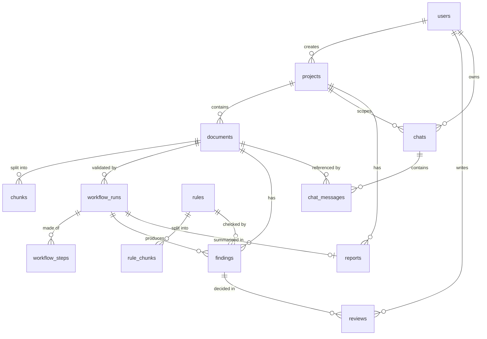

# FiberDoc AI – Database schema

Target schema for all FiberDoc data, based on blueprint section 8 ([`blueprint.md`](blueprint.md)) plus what the
app needs beyond it (chat history, workflow runs, versioned reports).

**Where it lives:** one PostgreSQL database with the pgvector extension. Relational data and embeddings sit in the
same tables. Today that is the local Postgres 18 service (database `fiberdoc`); for deployment it moves unchanged to
a hosted Postgres with pgvector (Neon, Supabase or Cloud SQL). Uploaded file bytes stay out of the database: on local
disk now (`backend/data/uploads`), object storage when deployed. Only the storage key is kept in `documents`.

**Legend:** ✅ exists · ✏️ exists, columns change · 🆕 new table

## Overview

| # | Table | State | Holds | Added in roadmap step |
|---|---|---|---|---|
| 1 | `users` | ✏️ | Demo accounts and reviewer roles | Auth |
| 2 | `projects` | ✏️ | Telecom projects that group documents | Auth / API |
| 3 | `documents` | ✏️ | Uploaded file metadata, status, checksum, version | 7-node workflow |
| 4 | `chunks` | ✏️ | Extracted text + embedding `vector(768)` | Classifier / sections |
| 5 | `rules` | ✅ | The curated demo rule catalogue | – |
| 6 | `rule_chunks` | 🆕 | Searchable rule text + embedding `vector(768)` | Recall@K |
| 7 | `findings` | ✏️ | One result per rule per document, with evidence and traceability | Risk and confidence |
| 8 | `reviews` | 🆕 (replaces `review_comments`) | Every human decision and comment, with history | Auth |
| 9 | `audit_events` | ✏️ | Append-only record of important actions | Auth |
| 10 | `chats` | ✅ 0002 | Chat conversations | Chat storage (table built; API next) |
| 11 | `chat_messages` | ✅ 0002 | User and assistant messages, linked to uploads | Chat storage (table built; API next) |
| 12 | `workflow_runs` | 🆕 | One row per validation run: status, versions, risk score, errors | Risk / 7-node workflow |
| 13 | `workflow_steps` | 🆕 | One row per graph node per run: latency, tokens, model | Observability |
| 14 | `reports` | 🆕 | Versioned generated reports | 7-node workflow |
| – | LangGraph checkpoint tables | auto | Paused workflow state for resume after review | 7-node workflow |
| (15) | `geo_features` | 🆕 later | GeoJSON boundary and route points (PostGIS) | GIS extension |

So: **8 tables exist, 6 are new** (one of them replaces `review_comments`), plus 1 later for GIS. LangGraph creates
and manages its own checkpoint tables when its Postgres checkpointer is set up; we don't design those.

Only **2 tables are needed now**, for chat storage: `chats` and `chat_messages`. The rest are added with the roadmap
step that uses them, so no table exists before something writes to it.

## Relationships

## Tables

Conventions: string IDs (12 hex characters, as today); every table has `created_at`, and mutable tables have
`updated_at`; timestamps are `timestamptz`; every foreign key gets an index.

### 1. `users` ✏️
| Column | Type | Notes |
|---|---|---|
| id | varchar PK | |
| email | varchar unique | |
| name | varchar | |
| role | varchar | `engineer` · `reviewer` · `admin` |
| password_hash | varchar | 🆕 for demo login (bcrypt/argon2), never the password |
| created_at | timestamptz | 🆕 |

### 2. `projects` ✏️
| Column | Type | Notes |
|---|---|---|
| id | varchar PK | |
| name | varchar | |
| location | varchar | |
| region | varchar | 🆕 matched against `rules.jurisdiction` |
| project_type | varchar | 🆕 e.g. `fiber_build`, `ftth` |
| created_by | FK → users | 🆕 nullable until auth exists |
| created_at, updated_at | timestamptz | `updated_at` 🆕 |

### 3. `documents` ✏️
| Column | Type | Notes |
|---|---|---|
| id | varchar PK | |
| project_id | FK → projects | indexed |
| name | varchar | original filename |
| doc_type | varchar | set by the classifier |
| status | varchar | `uploaded` · `processing` · `awaiting_review` · `reviewed` · `error` |
| page_count | int | |
| error | text | |
| sha256 | varchar(64) | checksum; indexed with project_id (duplicate detection) |
| storage_key | varchar | renamed from `stored_path`; disk path now, object key when deployed |
| version | int | 🆕 1, 2, 3… when the same filename is re-uploaded to a project |
| uploaded_by | FK → users | 🆕 nullable until auth |
| created_at, updated_at | timestamptz | `updated_at` 🆕 |

### 4. `chunks` ✏️
| Column | Type | Notes |
|---|---|---|
| id | varchar PK | |
| document_id | FK → documents | indexed |
| page | int | |
| section | varchar | 🆕 heading the chunk sits under (e.g. "3. Underground construction") |
| kind | varchar | `text` · `table` |
| text | text | |
| embedding | vector(768) | HNSW index once data grows |

### 5. `rules` ✅
Unchanged: id, title, text, severity, applies_to, keywords, check_type, params, source_name, section, jurisdiction,
standard_family, version, effective_date, status, embedding. `updated_at` 🆕.

### 6. `rule_chunks` 🆕
Searchable knowledge-base text, separate from the rule record (blueprint section 6: "stored as a separate rule
record and as searchable text"). Today each rule is one chunk; the table allows a long rule, or its guidance notes,
to become several.
| Column | Type | Notes |
|---|---|---|
| id | varchar PK | |
| rule_id | FK → rules | indexed |
| rule_version | varchar | the rule version this text belongs to |
| content | text | exact text passed to the Validate node |
| metadata | jsonb | doc types, jurisdiction, standard family (filters before ranking) |
| embedding | vector(768) | |
| created_at | timestamptz | |

### 7. `findings` ✏️
| Column | Type | Notes |
|---|---|---|
| id | varchar PK | |
| project_id | FK → projects | indexed |
| document_id | FK → documents | indexed |
| workflow_run_id | FK → workflow_runs | 🆕 which run produced it |
| rule_id | FK → rules | |
| title | varchar | |
| requirement | text | 🆕 rule text as applied (blueprint example field) |
| status | varchar | `passed` · `failed` · `missing_evidence` · `needs_review` |
| severity | varchar | `high` · `medium` · `low` |
| source | varchar | `rule` (deterministic) · `ai` |
| evidence | jsonb | `[{page, quote}]` |
| source_pages_checked | jsonb | `[int]` |
| explanation | text | |
| recommended_action | text | |
| needs_human_review | boolean | |
| confidence | varchar | 🆕 `high` · `medium` · `low` |
| confidence_reason | text | 🆕 e.g. "low: scanned page, OCR text" |
| risk_points | numeric | 🆕 severity weight × status multiplier |
| retrieval | jsonb | rule as used, rank and scores, evidence chunks |
| decision | varchar | latest decision, mirrored from `reviews` for fast filtering |
| created_at, updated_at | timestamptz | `updated_at` 🆕 |

`evidence_page` and `evidence_quote` are removed once every finding has the `evidence` list.

### 8. `reviews` 🆕 (replaces `review_comments`)
Every decision is its own row, so the history is kept. Today only the latest decision survives; earlier ones are
only in the audit log.
| Column | Type | Notes |
|---|---|---|
| id | varchar PK | |
| finding_id | FK → findings | indexed |
| reviewer_id | FK → users | nullable until auth; `reviewer_name` until then |
| decision | varchar | `approved` · `rejected` · `changes_requested` · `comment` (comment only) |
| comment | text | |
| reviewed_at | timestamptz | |

Existing `review_comments` rows are copied in as `decision='comment'`.

### 9. `audit_events` ✏️
| Column | Type | Notes |
|---|---|---|
| id | varchar PK | |
| created_at | timestamptz | renamed from `at` |
| actor_id | FK → users | 🆕 nullable; `actor` text kept for "system" |
| action | varchar | e.g. `document_uploaded`, `finding_reviewed` |
| entity_type | varchar | renamed from `entity` |
| entity_id | varchar | indexed with entity_type (audit timeline) |
| payload | jsonb | renamed from `detail` |

Append-only: the app never updates or deletes rows. A database trigger can enforce this.

### 10. `chats` 🆕
| Column | Type | Notes |
|---|---|---|
| id | varchar PK | |
| user_id | FK → users | nullable until auth |
| project_id | FK → projects | nullable; the project picked in the chat |
| title | varchar | first message or first filename |
| created_at, updated_at | timestamptz | `updated_at` orders "Recent chats" |

### 11. `chat_messages` 🆕
| Column | Type | Notes |
|---|---|---|
| id | varchar PK | |
| chat_id | FK → chats | indexed with created_at |
| role | varchar | `user` · `assistant` |
| text | text | |
| document_id | FK → documents | nullable; the upload this message is about (opens the result panel) |
| kind | varchar | `text` · `upload` · `result` · `error` |
| created_at | timestamptz | |

The assistant's result message is written by the **backend** when the workflow finishes, so it's saved even if the
browser was closed.

### 12. `workflow_runs` 🆕
| Column | Type | Notes |
|---|---|---|
| id | varchar PK | the run ID logged with every step (blueprint section 12) |
| document_id | FK → documents | indexed |
| status | varchar | `running` · `awaiting_review` · `completed` · `error` |
| doc_type | varchar | classifier result for this run |
| retrieved_rules | jsonb | full ranked list with scores (input for Recall@K; moves here from the audit event) |
| risk_score | numeric | 0–100 |
| risk_band | varchar | `low` · `medium` · `high` |
| completeness | numeric | share of rules passed |
| model_version | varchar | e.g. `gemini-3.8-flash` |
| embed_model_version | varchar | |
| prompt_version | varchar | version of the semantic-check prompt |
| catalogue_version | varchar | rule catalogue version |
| errors | jsonb | |
| started_at, finished_at | timestamptz | |

### 13. `workflow_steps` 🆕
| Column | Type | Notes |
|---|---|---|
| id | varchar PK | |
| run_id | FK → workflow_runs | indexed |
| node | varchar | `intake` · `extract` · `retrieve` · `validate` · `risk_score` · `human_review` · `report` |
| status | varchar | `ok` · `error` |
| latency_ms | int | |
| input_tokens, output_tokens | int | Gemini calls made by this node |
| llm_calls | int | |
| error | text | |
| started_at | timestamptz | |

### 14. `reports` 🆕
| Column | Type | Notes |
|---|---|---|
| id | varchar PK | |
| project_id | FK → projects | |
| document_id | FK → documents | nullable: null = project-wide report |
| workflow_run_id | FK → workflow_runs | nullable |
| version | int | increments per regeneration |
| risk_score, risk_band | numeric, varchar | as at generation time |
| storage_key | varchar | generated HTML/PDF on disk or object storage |
| generated_by | FK → users | nullable |
| created_at | timestamptz | |

### 15. `geo_features` 🆕 later (GIS extension, needs PostGIS)
| Column | Type | Notes |
|---|---|---|
| id | varchar PK | |
| project_id | FK → projects | |
| document_id | FK → documents | the uploaded GeoJSON file |
| kind | varchar | `boundary` · `route_point` |
| geom | geometry(Geometry, 4326) | |
| properties | jsonb | |
| valid | boolean | |
| issue | text | e.g. "point outside project boundary" |

## How the schema gets changed

Schema changes are **Alembic** migrations (since 2026-11-14): one versioned, reversible script per change in
`backend/migrations/versions/`, applied automatically at startup. `0001` is the baseline (the 8 original tables) and
`0002` adds the chat tables. See `backend/migrations/README.md` for how to add one.
